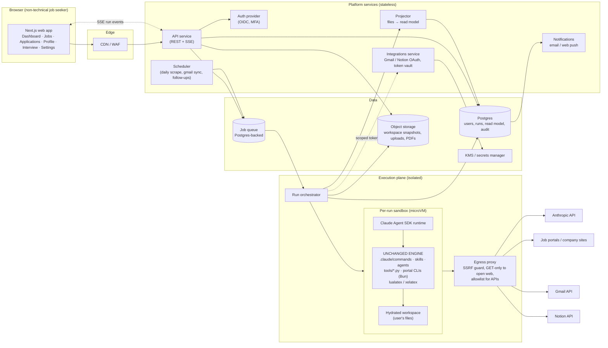
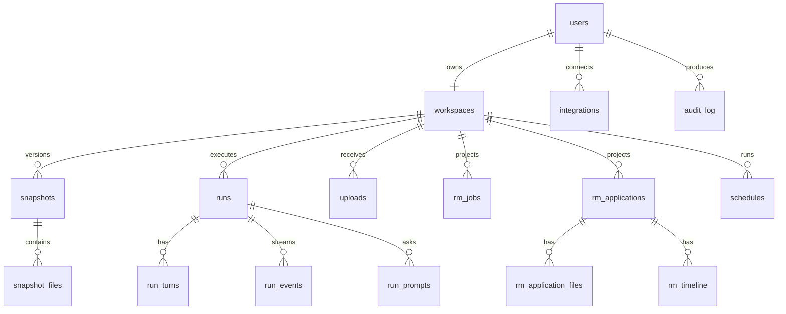
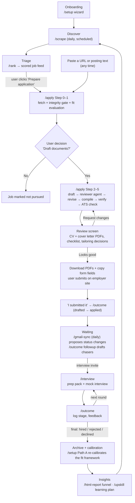
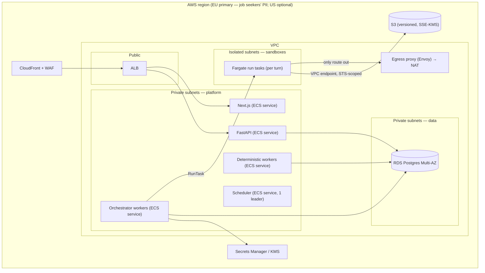

# AI Job Search — Web Application Architecture

Status: proposal · Scope: product and system architecture, no code · Audience: engineering + product

---

## 0. Executive summary

The repository is already a complete job-search **engine**. It just has a terminal UI. Its business
logic lives in four places:

| Layer | What it is | Examples |
|---|---|---|
| **Commands** (`.claude/commands/*.md`) | Long, multi-step natural-language programs that Claude executes | `/apply`, `/rank`, `/outcome`, `/setup` |
| **Skills** (`.claude/skills/`, `.agents/skills/`) | Knowledge + sub-workflows loaded on demand | fit framework, writing style, `/scrape`, `/upskill`, portal CLIs |
| **Agents** (`.claude/agents/`) | Sandboxed sub-agents with reduced tool sets | `posting-fetcher`, `posting-scorer`, `application-reviewer` |
| **Deterministic tools** (`tools/*.py`, `salary_lookup.py`, Bun CLIs) | Tested Python/TS that does state, parsing, verification, security | `rank_state.py`, `scrape_state.py`, `posting_guard.py`, `verify_pdf.py` |

Its **system of record is a file tree**: `job_search_tracker.csv`, `job_scraper/seen_jobs.json`,
the profile markdown files, `documents/applications/<company>_<role>/`, generated `.tex`/`.pdf`.

**The core design decision:** we do not port any of this to a web backend. Each user gets a
private, versioned **workspace** (a copy of the repo + their personal files). The web app runs the
unmodified commands inside that workspace with the **Claude Agent SDK** (the programmable Claude
Code runtime, which natively loads `.claude/commands`, `.claude/agents`, `.claude/skills` and
`.claude/settings.json`), in a per-run sandbox. A thin platform layer around it adds what a
non-technical user needs: accounts, a structured UI, background jobs, notifications, file storage,
integrations, and undo.

The database is a **read model** (a projection of the workspace files for fast UI queries), never
a second source of truth. Every mutation still flows through the existing commands and tools.

---

## 1. High-level architecture



**Three planes:**

1. **Experience plane** — the web UI. Never talks to the engine directly.
2. **Platform plane** — auth, API, read model, scheduling, integrations. Stateless, horizontally
   scaled, knows nothing about job-search rules.
3. **Execution plane** — runs the engine. One sandbox per run, hydrated from the user's workspace
   snapshot, torn down afterwards. The only place an LLM, a shell, or untrusted web content exists.

---

## 2. Recommended tech stack

| Concern | Choice | Why |
|---|---|---|
| Frontend | **Next.js (React, TypeScript)**, Tailwind, shadcn/ui, TanStack Query | Mature, accessible component kit; SSR for fast first paint; good form/wizard ergonomics |
| PDF viewing | **pdf.js** | Render generated CVs/cover letters inline with page boundaries visible |
| Realtime | **Server-Sent Events** | Run progress is one-directional streaming; simpler than WebSockets behind proxies |
| API service | **Python 3.12 + FastAPI** | Same language as `tools/*.py`, so the projector and the deterministic lane can import or shell out to them without a second runtime |
| Agent runtime | **Claude Agent SDK (Python)** with `setting_sources=["project"]` | Loads the repo's commands, agents, skills, and `settings.json` permission rules unchanged; supports session resume, streaming, `can_use_tool` callbacks, MCP servers |
| Queue | **Postgres-backed queue** (e.g. Procrastinate / pg-boss pattern) | Runs are low-volume, long-lived, and must be transactional with run state. One less system than Redis+Celery. Revisit at scale |
| Database | **Postgres 16** (managed) | Relational read model + JSONB for run events and flexible job fields |
| Object storage | **S3** (versioning + SSE-KMS) | Workspace snapshots, uploads, PDFs |
| Sandbox | **AWS ECS Fargate tasks** (Firecracker microVM per task) — alternative: E2B / Modal sandboxes | Hard isolation for code that executes LLM-chosen shell commands and third-party portal CLIs |
| Worker image | Debian + Python 3.12 + **Bun** + **TeX Live** (lualatex, xelatex, moderncv, fontawesome5) + Claude Code CLI + poppler-utils + pypdf | Exactly what the engine already expects (`verify_pdf.py` uses pypdf/pdftotext) |
| Egress | **Envoy or Squid** forward proxy | Enforce SSRF rules, method restrictions, per-host rate limits, audit |
| Auth | **Managed OIDC** (Clerk, Auth0, or Cognito) | Passwordless/social login, MFA, no password storage |
| Secrets | **AWS KMS + Secrets Manager** | Envelope-encrypt OAuth tokens and per-user BYO API keys |
| Observability | OpenTelemetry → Grafana/Datadog; Sentry for frontend/API | Trace a run from button click to sandbox exit |
| IaC / CI | Terraform; GitHub Actions (existing CI stays; add image build + e2e) | |

---

## 3. Key architectural concepts

### 3.1 Workspace = the user's copy of the repo

```
workspace/<user_id>/
├── (framework files, pinned to framework version vX.Y)
│   .claude/commands, .claude/agents, .claude/skills (framework parts), tools/, .agents/skills/*, cv/main_example.tex, cover.cls, fonts
├── (personalised framework files — written by /setup, /expand, /add-template, /add-portal)
│   CLAUDE.md, .claude/skills/job-application-assistant/01..07*.md, search-queries.md, custom portals/templates
└── (personal data — gitignored upstream)
    job_search_tracker.csv, job_scraper/seen_jobs.json, documents/**, cv/main_*.{tex,pdf},
    cover_letters/cover_*.*, reports/, upskill/, company_research/*.json, gmail_sync/state.json,
    salary_data.json
```

- **Stored as content-addressed snapshots.** After every run the orchestrator hashes every file,
  uploads changed blobs to S3 (`blobs/<sha256>`), and writes a **snapshot manifest** (path → sha)
  in Postgres. A workspace is a pointer to its current manifest.
- This gives **undo for free** ("Restore the state before this run"), a full audit trail, and a
  safety net under `/reset`.
- **Framework upgrades** are a three-way merge between the old framework version, the new one, and
  the user's personalised files, run by the platform (reusing the logic behind
  `tools/check_upstream_updates.py`). Profile files that `/setup` personalised always keep the
  user's side; conflicts in framework-owned files take upstream.

### 3.2 Run = one command invocation, possibly many turns

A **run** is "execute `/apply <url>` for this user". Most commands are *conversational*: they stop
and wait for the user (apply's "Should I proceed with drafting?", gmail-sync's approval batch,
reset's confirmation, setup's interview). We never keep a sandbox alive while a human thinks.

- Each **turn** is one queued job: hydrate workspace → resume the Agent SDK session → run until the
  agent ends its turn → persist session transcript + workspace snapshot → tear down.
- When the agent ends a turn with a question, the run enters `awaiting_input`. The UI shows a
  prompt card; the user's answer enqueues the next turn with `resume=<sdk_session_id>`.
- Hours or days can pass between turns (e.g. the user reviews a CV draft tomorrow).

### 3.3 Two execution lanes

| Lane | Used for | Mechanism | Latency |
|---|---|---|---|
| **Agent lane** | Anything a command does | Agent SDK runs `/<command> <args>` in a sandbox | 30 s – 15 min |
| **Deterministic lane** | Read-only queries and pure tools, no LLM | Worker invokes the existing Python tool directly | < 2 s |

Deterministic-lane examples (no new logic, just calling what exists):
`rank_state.py candidates` (how many jobs are waiting to be ranked), `rank_state.py sweep`
(closing-soon list), `verify_pdf.py` (re-check a PDF the user replaced), `salary_lookup.py`
(salary lookup on a job card), `convert_salary_excel.py` (salary data upload), `job_key.py --audit`.

### 3.4 Interaction adapter (the only "glue" we add to prompts)

Commands are unchanged. The orchestrator appends a short **platform system prompt** to every run:

- "You are running inside a web application for a non-technical user. When you need a decision
  from the user, use the `AskUserQuestion` tool with concrete options rather than asking in prose.
  Do not mention file paths, git, LaTeX, or terminal commands to the user; refer to 'your CV',
  'your tracker', etc."
- "Never run `git push`. Never ask the user to edit files by hand."

Plus a **`can_use_tool` callback** that (a) turns `AskUserQuestion` calls into UI prompt cards,
(b) enforces platform policy on top of `.claude/settings.json` (e.g. denies any `Edit` to
`tools/**` or `.agents/**` outside `/add-portal`), (c) maps the repo's `ask` permissions to a UI
approval card or an automatic policy decision.

Structured UI data comes from **files, not prose**: after each turn, the projector reads the
tracker, `seen_jobs.json`, outcome files, generated PDFs and reports. The agent's prose is shown as
a readable activity log, but screens are driven by parsed state.

### 3.5 Read model (projection)

The **projector** runs after every snapshot. It parses `job_search_tracker.csv`, `seen_jobs.json`,
`documents/applications/*/outcome.md`, profile markdown, `upskill/report-*.md`, and file listings,
then upserts Postgres tables. It tolerates the same legacy formats the commands tolerate (13-column
tracker rows, legacy `no response` spelling, missing `deadline`/`posted_date`), and is covered by
the existing fixture tests plus new contract tests against the same fixtures.

---

## 4. Backend API design

REST, JSON, versioned under `/api/v1`. All routes are scoped to the authenticated user's workspace;
there is no `workspace_id` in public URLs.

### 4.1 Runs (generic command execution)

| Method & path | Purpose |
|---|---|
| `POST /runs` | Start a run. Body: `{command: "apply", args: {...}, idempotency_key}`. Returns `run_id`. Server builds the slash-command string from validated args (never accepts a raw prompt) |
| `GET /runs/{id}` | Run status: `queued · running · awaiting_input · succeeded · failed · cancelled` + summary |
| `GET /runs/{id}/events` (SSE) | Live stream: `step_started`, `log`, `tool_activity`, `prompt`, `artifact_created`, `state_changed`, `finished` |
| `POST /runs/{id}/input` | Answer a pending prompt: `{prompt_id, choice | text}` → enqueues next turn |
| `POST /runs/{id}/cancel` | Cancel; current turn is interrupted, snapshot not committed |
| `GET /runs?command=&status=` | Run history (Activity page) |
| `POST /runs/{id}/revert` | Restore the workspace snapshot that preceded this run |

Command-specific args schemas (validated server-side, rendered into the slash string):

| command | args |
|---|---|
| `setup` | `{path: "documents"|"cv"|"interview", section?, cv_upload_id?}` |
| `apply` | `{posting_url?} | {posting_text?}` (exactly one) |
| `scrape` | `{}` |
| `rank` | `{focus?, all?, limit?, top?}` |
| `interview` | `{application_id}` |
| `outcome` | `{application_id?, mode: "update"|"followup"|"stale", days?}` |
| `expand` | `{}` |
| `gmail_sync` | `{application_id?, since?}` |
| `notion_sync` | `{min_score?, all?, rebuild?}` |
| `html_report` | `{}` |
| `upskill` | `{posting_url?}` |
| `add_portal` | `{portal_url?, name?, market?, language?, test_query?}` |
| `add_template` | `{mode: "add"|"list"|"switch", kind?: "cv"|"cover", upload_id?, template_name?}` |
| `reset` | `{scope: "profile"|"documents"|"all"}` |

### 4.2 Read-model resources (fast, no LLM)

| Method & path | Purpose |
|---|---|
| `GET /dashboard` | Pipeline counts, next actions (deadlines, follow-ups due, interviews), recent runs |
| `GET /jobs?status=&min_score=&q=&sort=` | Scraped/ranked jobs (projection of `seen_jobs.json`) |
| `GET /jobs/{key}` | Job detail: score, verdicts, strengths/gaps, deadline, portal, posting digest |
| `POST /jobs/{key}/dismiss` | Mark not interested (deterministic lane via `rank_state.py`/`scrape_state.py` if supported; otherwise queued as a tiny agent run) |
| `GET /applications?status=` | Tracker rows |
| `GET /applications/{id}` | Row + archive: posting, fit evaluation, CV/cover files, form fields, outcome timeline, prep packs |
| `GET /profile` | Parsed profile sections (from `CLAUDE.md`, `01`, `02`, `07`) for display |
| `GET /profile/completeness` | Placeholder scan (same idea as `test_placeholder_integrity.py`) → onboarding checklist |
| `GET /insights` | Funnel stats (same bucket map as `/html-report`) + latest upskill report |
| `GET /templates`, `GET /portals` | Registered templates / portal skills |

### 4.3 Files

| Method & path | Purpose |
|---|---|
| `POST /uploads` | Get a pre-signed S3 PUT URL. Body: `{category: cv|linkedin|diploma|reference|project|posting|template|salary_data, filename, size, mime}` |
| `POST /uploads/{id}/complete` | Virus scan + type sniff → attach into `documents/<category>/` in a new workspace snapshot |
| `GET /files/{path}` | Pre-signed GET for a workspace file (PDF preview, download) |
| `DELETE /documents/{id}` | Remove an uploaded document (new snapshot) |
| `GET /export` | Full workspace zip (GDPR portability) |

### 4.4 Integrations, settings, account

| Method & path | Purpose |
|---|---|
| `GET /integrations` | Gmail / Notion connection status |
| `GET /integrations/{gmail|notion}/connect` → OAuth callback | Store refresh token encrypted |
| `DELETE /integrations/{provider}` | Revoke + delete token |
| `GET/PUT /settings` | Market, CV language, notification prefs, schedules, Anthropic key mode |
| `GET/PUT /schedules` | Daily scrape+rank, daily Gmail sync, follow-up reminder threshold |
| `DELETE /account` | Hard delete: workspace, blobs, tokens, read model |

### 4.5 Conventions

- Idempotency keys on every `POST` that enqueues work.
- **One writing run per workspace at a time** (advisory lock on workspace id). Additional runs queue
  behind it; the UI shows "waiting for your previous task to finish".
- Errors use RFC 7807 problem+json with a user-facing `title` written for non-technical readers.

---

## 5. Database schema

Postgres holds platform state and the read model. **Files remain the system of record**; every
read-model table can be dropped and rebuilt from the latest snapshot.



### Platform tables

| Table | Key columns |
|---|---|
| `users` | `id, auth_subject, email, display_name, created_at, plan, deleted_at` |
| `workspaces` | `id, user_id, framework_version, current_snapshot_id, market, cv_language, settings jsonb, lock_run_id` |
| `snapshots` | `id, workspace_id, parent_id, created_by_run_id, reason, created_at` |
| `snapshot_files` | `snapshot_id, path, sha256, size, mode` (blob at `s3://…/blobs/<sha256>`) |
| `runs` | `id, workspace_id, command, args jsonb, status, trigger (user|schedule), sdk_session_id, base_snapshot_id, result_snapshot_id, cost_usd, tokens_in, tokens_out, error, created_at, finished_at` |
| `run_turns` | `id, run_id, seq, input jsonb, started_at, finished_at, exit_reason` |
| `run_events` | `id, run_id, seq, type, payload jsonb, ts` (partitioned by month, TTL 90 days) |
| `run_prompts` | `id, run_id, turn_id, kind (choice|text|approval|batch_approval), question, options jsonb, answer jsonb, answered_at` |
| `uploads` | `id, workspace_id, category, filename, sha256, mime, size, scan_status, workspace_path` |
| `integrations` | `id, user_id, provider, scopes, token_ciphertext, kms_key_id, status, connected_at` |
| `schedules` | `id, workspace_id, command, args jsonb, cron, enabled, last_run_id` |
| `notifications` | `id, user_id, kind, payload jsonb, read_at` |
| `audit_log` | `id, user_id, actor (user|system|agent), action, target, metadata jsonb, ts` |
| `usage` | `user_id, period, runs, tokens, cost_usd` |

### Read-model tables (prefix `rm_`, rebuilt by the projector)

| Table | Source | Key columns |
|---|---|---|
| `rm_jobs` | `job_scraper/seen_jobs.json` | `workspace_id, key, title, company, url, location, portal, source, first_seen, posted_date, deadline, employment_type, fit, status, rank_score, rank_verdict, rank_date, location_verdict, language_gate, language_note, strengths jsonb, gaps jsonb` |
| `rm_applications` | `job_search_tracker.csv` | `workspace_id, row_index, date, company, sector, role, role_type, channel, status, status_bucket, contact_person, fit_rating, notes, cv_file, cover_letter_file, source, deadline, archive_dir` |
| `rm_application_files` | `documents/applications/<dir>/*`, `cv/`, `cover_letters/` | `application_id, kind (posting|cv_src|cv_pdf|cover_src|cover_pdf|form_fields|prep_pack|outcome|followup), path, stage` |
| `rm_timeline` | dated notes + `outcome.md` stages | `application_id, date, event, detail` |
| `rm_profile_sections` | profile markdown | `workspace_id, section, completeness, placeholder_count` |
| `rm_insights` | computed like `/html-report` + `upskill/report-*.md` | `workspace_id, funnel jsonb, latest_upskill_path` |

---

## 6. Authentication & authorization model

**End users**
- Managed OIDC provider: email magic link + Google/LinkedIn/Apple sign-in; optional TOTP/passkey MFA.
- Short-lived session JWT (15 min) + rotating refresh cookie (`HttpOnly`, `Secure`, `SameSite=Lax`).
- One user ↔ one workspace in v1. Authorization is ownership: every query is filtered by the
  user's `workspace_id`, enforced with Postgres row-level security as defence in depth.

**Third-party integrations (per user, explicit consent)**
- **Gmail:** Google OAuth, scope `gmail.readonly` only (gmail-sync never sends or modifies mail).
  Note: this is a *restricted* scope — a public launch needs Google's verification + CASA security
  assessment. Budget 6–10 weeks; until then run as "testing" with ≤100 users.
- **Notion:** Notion public integration OAuth; user picks the page the database lives under.
- Tokens are envelope-encrypted (KMS), never sent to the browser, never written into the workspace.
  At run time the orchestrator mints a run-scoped MCP server config holding a short-lived access
  token, **only for runs that need it** (`gmail_sync` gets Gmail, `notion_sync` gets Notion,
  nothing else gets either).
- MCP servers are registered under the names the commands already check for
  (`claude_ai_Gmail` → `mcp__claude_ai_Gmail__*`, `notion` → `mcp__notion__*`), so the commands'
  preflight steps work unchanged.

**Anthropic API access** — two modes:
1. *Platform-billed* (default for non-technical users): platform key, per-user metering and caps.
2. *Bring your own key*: stored like OAuth tokens; injected per run.

**Sandboxes** get no user credentials beyond the run-scoped tokens above, and an S3 credential
scoped by STS session policy to that one workspace's snapshot prefix.

**Staff/admin**: separate IdP group, just-in-time elevation, every workspace read audited; support
staff cannot read workspace content without a user-granted, time-boxed support token.

---

## 7. Job application workflow (end-to-end, user's view)



The UI frames this as a **pipeline**: *Discover → Shortlist → Drafting → Ready to submit → Applied
→ Interviewing → Offer → Closed*, mapping 1:1 onto the tracker vocabulary
(`drafted | applied | interview | offer | hired | rejected | no_response | offer_declined | withdrawn`).

---

## 8. Agent execution workflow (what happens in one turn)

```mermaid
sequenceDiagram
  autonumber
  participant UI
  participant API
  participant Q as Queue
  participant O as Orchestrator
  participant S as Sandbox (Agent SDK)
  participant S3
  participant DB as Postgres

  UI->>API: POST /runs {command: apply, args: {posting_url}}
  API->>DB: insert run (queued), validate args, check quota
  API->>Q: enqueue turn 1
  API-->>UI: run_id (UI subscribes to SSE)
  Q->>O: dequeue (acquire workspace lock)
  O->>S3: fetch snapshot manifest + blobs
  O->>S: start microVM, mount hydrated workspace, inject run-scoped creds
  S->>S: query("/apply <url>", setting_sources=[project], append_system_prompt=adapter, can_use_tool=policy)
  S-->>O: stream messages (text, tool_use, subagent start/stop)
  O-->>DB: run_events (step markers parsed from "## Step N" progress + tool activity)
  DB-->>UI: SSE events (progress bar: "Checking the posting…", "Evaluating fit…")
  S->>O: AskUserQuestion("Draft the CV and cover letter?", [Yes, No])
  O->>DB: run_prompt + session transcript; status=awaiting_input
  O->>S3: snapshot changed files (archive, tracker untouched yet)
  O->>S: terminate sandbox; release lock
  UI->>API: POST /runs/{id}/input {Yes}
  API->>Q: enqueue turn 2 (resume=sdk_session_id)
  Q->>O: dequeue → hydrate → resume session
  S->>S: Steps 2–6: posting-fetcher / application-reviewer subagents, lualatex/xelatex, verify_pdf.py, verify_layout.py, tracker row written
  S-->>O: done
  O->>S3: snapshot (new cv/*.pdf, cover_letters/*.pdf, tracker, archive)
  O->>DB: projector updates rm_* tables; run succeeded; cost recorded
  DB-->>UI: SSE finished → navigate to Application review screen
```

**Run-time guarantees**
- **Timeouts:** per turn (default 20 min; `/apply` 30 min), per run (7 days awaiting input then
  auto-cancel with workspace untouched by the unfinished turn).
- **Atomicity:** a turn's file changes are committed as one snapshot only on clean turn end. Crash
  or cancel → snapshot discarded, workspace is exactly as before the turn.
- **Retries:** infrastructure failures (sandbox start, network) retry with backoff; model/logic
  failures do not auto-retry (avoid duplicate tracker rows) — the user sees "Try again".
- **Progress mapping:** commands already have numbered `## Step N:` headings. The orchestrator ships
  a small per-command step map (title → friendly label) so the progress bar is meaningful without
  touching command text.
- **Subagents** (`posting-fetcher`, `posting-scorer`, `application-reviewer`) run inside the same
  sandbox via the SDK's native agent support, keeping their reduced tool sets.

---

## 9. Queue / background job design

| Queue | Work | Concurrency | Notes |
|---|---|---|---|
| `interactive` | User-initiated turns | High priority; per-workspace serial | Target start < 30 s (warm pool) |
| `scheduled` | Daily `/scrape` → `/rank`, `/gmail-sync`, follow-up scan | Low priority, spread with jitter across the night in user's time zone | Skipped if an interactive run holds the lock; retried later |
| `deterministic` | Python-tool calls (salary lookup, sweep, verify_pdf, projector rebuilds) | Many; lightweight container, no LLM, no open-web egress | Sub-second |
| `maintenance` | Framework upgrades, snapshot GC, event TTL, account deletion | Single-digit | |

**Job record:** `{run_id, turn_seq, workspace_id, command, priority, attempts, not_before, lease_until}`.

**Patterns**
- **Workspace lock**: `SELECT … FOR UPDATE SKIP LOCKED` on the job + advisory lock on workspace;
  a second writing job for the same workspace is deferred, not failed.
- **Leases + heartbeats** so a dead worker's job returns to the queue.
- **Chained scheduled jobs**: nightly `scrape` success enqueues `rank` (the commands are designed to
  compose this way). Results land as a morning notification: "7 new jobs, 2 strong fits".
- **Scheduled runs that need a human** (gmail-sync's approval batch, rank's nothing-to-do) stop at
  `awaiting_input`; the user gets "3 status updates from your inbox are waiting for approval".
  Gmail-sync never writes without approval — that rule is in the command and the UI preserves it.
- **Cost guardrails**: per-user daily token budget; scheduled jobs are the first to be skipped when
  near the cap; `/rank --limit` defaults stay as-is.
- **Warm pool**: keep N pre-started sandboxes with the image loaded (TeX Live is large); assign a
  workspace on dequeue.

---

## 10. File storage design

```
s3://ajs-workspaces-<env>/
  blobs/<sha256>                      # content-addressed, deduplicated, SSE-KMS
  sessions/<run_id>/transcript.jsonl  # Agent SDK session for resume (encrypted)
  framework/<version>/tree.tar.zst    # read-only framework baseline per release
  exports/<user_id>/<ts>.zip          # short-lived, 24 h lifecycle
s3://ajs-uploads-quarantine-<env>/
  <upload_id>                         # pre-signed PUT lands here; scanned before promotion
```

- **Upload flow:** browser → pre-signed PUT to quarantine → ClamAV + MIME sniffing + size limits
  (PDF/DOCX/TXT/TEX/XLSX/images ≤ 20 MB) → promoted into blobs and mapped to
  `documents/<category>/<sanitised name>` in a new snapshot. Filenames sanitised (no path traversal).
- **Hydration:** the orchestrator materialises the manifest into the sandbox's ephemeral disk
  (framework baseline tarball + per-user blobs). Typical workspace is a few MB plus uploads.
- **Generated artifacts** (CV/cover PDFs, `reports/application-dashboard.html`, upskill reports,
  prep packs) are just workspace files; the UI fetches them via pre-signed GETs with short TTL and
  `Content-Disposition` set. The HTML dashboard is served from a sandboxed origin
  (`usercontent.` domain, CSP `sandbox`) since it is model-generated HTML.
- **Retention:** S3 versioning + snapshot GC keeps the last 50 snapshots plus daily snapshots for
  90 days; deleting the account deletes all blobs not shared (blobs are per-workspace-prefixed in
  practice to make deletion and STS scoping trivial — dedup only within a workspace).
- **Personal data never enters git or any shared store.** The upstream `.gitignore` rules remain the
  policy model for "what is personal".

---

## 11. Deployment architecture



- **Environments:** `dev`, `staging` (anonymised fixtures only), `prod`.
- **Sandbox subnets** have no route except the egress proxy and an S3 VPC endpoint; no access to
  RDS, metadata endpoint (IMDS blocked), or other services.
- **Image pipeline:** CI builds the worker image from a pinned framework release; runs the
  repo's existing test suite (`pytest`, `lint_skills.py`, `security_guards.py`, Bun CLI typecheck +
  tests, LaTeX smoke compiles) **inside the image** before promotion. Signed images (cosign).
- **Releases:** framework version bump → new image → canary 5 % of scheduled runs → full rollout →
  offer workspace upgrade to users (§3.1).
- **DR:** RDS PITR 14 days; S3 cross-region replication for blobs; read model is rebuildable.

---

## 12. Security considerations

The repo is already unusually defensive (posting integrity gate, trust-boundary rules, permission
allowlists, security guards). The web app must **preserve every one of those controls** and add the
ones a multi-tenant service needs.

**Prompt injection & untrusted content**
- Postings, company pages, emails and portal markup stay "data, never instructions". The existing
  `posting_guard.py` gate, read-only subagents, and "never fetch URLs found inside a posting" rules
  run unchanged.
- The platform adapter prompt is additive only and repeats the trust-boundary rule.
- Gmail access is read-only by scope; writes from gmail-sync require explicit approval in the UI.
- Notion sync is one-way out; the token is Notion-workspace-scoped and can only touch the page the
  user granted.

**Sandbox containment**
- One microVM per turn, non-root, read-only root filesystem except the workspace + scratch dir,
  CPU/memory/time limits, no IMDS, no inbound network.
- `.claude/settings.json` allow/ask/deny lists remain in force; the `can_use_tool` callback adds a
  platform deny-list (e.g. `git push`, writes outside the workspace, `Edit(tools/**)` except in
  `/add-portal`), and **`ask` rules never default to allow**.
- **Egress proxy:** block RFC1918/link-local/loopback/cloud-metadata (SSRF), block non-HTTP(S),
  GET/HEAD only to the open web (mirrors the repo's curl/wget POST deny rules), POST allowed only to
  Anthropic, Google, Notion APIs; per-host rate limits respect the portals; `robots_check.py`
  continues to run in-band.

**User-generated code (`/add-portal`, `/add-template`)**
- These produce code/templates that later execute. Gate activation on: `security_guards.py`,
  `lint_skills.py`, the generated CLI's typecheck + offline tests, and a mandatory live test — all
  already part of the commands. Generated code only ever runs in that user's sandbox; never shared
  across tenants. LaTeX compiles run with `-no-shell-escape`.
- Mark both as **Advanced** features with plain-language warnings.

**Data protection**
- PII everywhere (CVs, references, salary expectations, interview weaknesses). Encrypt at rest
  (KMS), TLS everywhere, EU data residency option, DPA with Anthropic, zero-data-retention option
  where available.
- GDPR: export (`GET /export`), erasure (`DELETE /account` + `/reset`), records of processing,
  consent capture for Gmail/Notion.
- Logs and run events are scrubbed of document bodies; transcripts are encrypted and expire.
- Model-generated HTML (dashboard) rendered on an isolated origin with strict CSP.

**Platform hygiene**
- CSRF protection on cookie auth; strict CSP on the app; rate limits per user and IP; idempotency
  keys; dependency review (existing CI) + container scanning; SBOM per image.
- Abuse: per-user run quotas; scheduled scraping volume capped so the platform never becomes a
  crawler; LinkedIn CLI is **personal-use only per its own ToS warning** — disable it by default
  in the hosted product and enable only per user with explicit acknowledgment (or drop it from the
  hosted image).

**Factual integrity (product-level safety)**
- The repo's Factual Grounding Audit and verification checklist stay mandatory; the UI shows the
  pass/fail checklist on every application and never hides failures.

---

## 13. Frontend page structure

```
/                         Landing + sign in
/onboarding               Privacy primer → upload documents → /setup wizard → first job search setup
/home                     Dashboard: next actions, pipeline snapshot, deadlines, recent activity
/jobs                     Job feed (ranked), filters, "Find new jobs" (/scrape), "Score jobs" (/rank)
/jobs/[key]               Job detail: score breakdown, strengths/gaps, gates, deadline, "Prepare application"
/apply/new                Paste URL or text → starts /apply
/applications             Pipeline board (kanban by status) + table view
/applications/[id]        Tabs: Overview · Posting · Fit evaluation · CV · Cover letter · Form fields
                          · Checklist · Timeline · Interview prep · Follow-ups
/applications/[id]/interview   Prep pack + mock interview (chat)
/inbox                    Approvals: pending prompts across runs (Gmail updates, confirmations)
/profile                  Profile sections (read view + "Update this section"), completeness meter
/profile/documents        Document library by category (CV, LinkedIn, diplomas, references, projects)
/profile/expand           "Discover more skills" (/expand) results and approvals
/insights                 Funnel & stats (native charts) · "Download report" (/html-report) · Skill gaps (/upskill)
/activity                 Run history, live run console, "Undo this change"
/settings
  /settings/integrations  Gmail · Notion
  /settings/search        Market, languages, job boards (portals) · "Add a job board" (/add-portal)
  /settings/templates     CV & cover letter designs · "Upload my own template" (/add-template)
  /settings/salary        Upload salary benchmark data
  /settings/schedules     Daily search, inbox check, follow-up reminders
  /settings/account       API key mode, export data, danger zone (/reset, delete account)
```

**Shared UI primitives**
- **Run Panel** — a slide-over shared by every command: friendly step progress, live activity log
  (collapsible "details"), prompt cards (buttons / text / approval lists), cancel button.
- **Prompt Card** — renders `AskUserQuestion` choices as buttons; free-text fallback always present.
- **Approval List** — checkbox list for batch approvals (gmail-sync, expand, setup Path A).
- **Document Viewer** — pdf.js with page count badge and "Request a change" box.
- **Checklist** — renders the verification checklist pass/fail.
- **Undo toast** — after any run that changed files: "Changes saved · Undo".

**Non-technical UX principles**
- No paths, no slash commands, no LaTeX, no git in the UI. Commands are verbs: "Find jobs",
  "Prepare application", "Log an update", "Practise interview".
- Every long task is backgroundable: "We'll notify you when it's ready."
- Every destructive action shows exactly what will change (reset already produces this list).
- Plain-language error states with one recovery action.

---

## 14. Command → UI mapping

Notation: **Screens** · **Inputs** · **Outputs** · **Interactions**. "Agent prompt" = a point where
the command waits for the user; it becomes a Prompt Card.

### `/setup` — Profile onboarding

| | |
|---|---|
| **Screens** | `/onboarding` wizard: (1) Welcome & privacy explainer, (2) "How do you want to start?" path chooser, (3a) Document upload, (3b) Single CV upload/paste, (3c) Guided interview (one section per step: Identity, Education, Experience, Skills, Publications & Awards, Behavioural, Career goals, References, Job search config), (4) Review proposed changes / conflicts, (5) Done → profile summary + "Find my first jobs". Re-entry: `/profile` → "Update this section" (`--section`) |
| **Inputs** | Path choice; uploaded files per category (CV, LinkedIn PDF, diplomas, references, projects, past applications); or pasted CV text; or answers to section questions; target sectors, deal-breakers, location/commute, languages + levels, CV language, market/portals |
| **Outputs** | Populated `CLAUDE.md`, `01`–`07` skill files, personalised `cv/main_example.tex`, `search-queries.md`; read model `rm_profile_sections`; completeness meter |
| **Interactions** | Path A: Approval List of additive changes per file; one Prompt Card per conflict ("Your CV says *Senior Analyst*, LinkedIn says *Analyst* — which is right?"). Path C: conversational Q&A in the Run Panel, one section at a time, Back/Skip. The command's public-fork warning is replaced by a platform privacy notice (no git remote exists in the hosted workspace) |

### `/apply` — Prepare an application

| | |
|---|---|
| **Screens** | Entry: "Prepare application" on a job card, or `/apply/new` (URL field + "Paste text instead"). Run Panel with steps: *Reading the posting → Safety check → Evaluating fit → (decision) → Drafting → Expert review → Revising → Building PDFs → Final checks*. Fit Evaluation card. Review screen (`/applications/[id]`): CV and Cover letter side by side, Checklist, Key tailoring decisions, Files |
| **Inputs** | Posting URL *or* pasted text. Optional: answers to follow-up questions (new facts), "Also draft application-form fields?" |
| **Outputs** | Fit evaluation (skills / experience / behavioural / salary benchmark / overall score + recommendation, language & location gates, posting-integrity verdict); `cv/main_<company>_<role>.pdf`, `cover_letters/cover_<company>_<role>.pdf`; verification checklist; ATS keyword coverage; tracker row (`drafted`); archived `job_posting.md`; optional form-fields `.txt` |
| **Interactions** | Prompt Card after evaluation: **Draft documents / Not for me**. Integrity warning banner if `posting_guard` flagged hidden content. Fact prompts: "You mention leading a team — how many people?" (answers are written back to the profile by the command's standing rule; UI labels them "Saved to your profile"). On review: **Request changes** (free text → new turn in same session), **Download PDFs**, **Copy form answers**, **I've submitted it** (starts `/outcome` → `applied`) |

### `/rank` — Score jobs

| | |
|---|---|
| **Screens** | `/jobs` feed: header with "X jobs waiting to be scored" (deterministic `rank_state.py candidates` count) and **Score jobs** button; Run Panel; resulting shortlist; sections *Closing soon*, *Below threshold*, *Excluded*, *Couldn't open — will retry*, *Check manually* |
| **Inputs** | Optional focus ("data science"), "Re-score everything" toggle (`--all`, suggested after profile changes), how many to score (`--limit`), shortlist size (`--top`) |
| **Outputs** | Updated `seen_jobs.json` → `rm_jobs` with score, verdict band, location/language gates, strengths/gaps, deadline; shortlist with "why these ranked highest" |
| **Interactions** | Sort/filter by score, deadline, portal; job card actions: **Prepare application** (`/apply` with URL), **Dismiss**, **Open posting**. Scheduled nightly after `/scrape`. Empty-state runs the expiry sweep and shows closing-soon list |

*(Related skill `/scrape`: **Find new jobs** button and nightly schedule on `/jobs`; inputs = nothing beyond profile/search config; outputs = new entries in the feed with fit high/medium/low, portal health warnings, referral contact links.)*

### `/interview` — Interview preparation

| | |
|---|---|
| **Screens** | From an application in *Interviewing* (or the home "Upcoming interviews" card): `/applications/[id]/interview`. Sections of the prep pack: Likely questions · Your STAR answers · Consistency brief (what your CV/letter claimed) · Tough questions · Questions to ask · Logistics. **Mock interview** chat view |
| **Inputs** | Application; interview stage (screen, technical, final…); optional date/format/interviewers; for mock: typed answers (voice in a later phase) |
| **Outputs** | `interview_prep_<stage>.md` in the application archive (rendered as a printable page); optionally new STAR examples appended to `07-interview-prep.md` |
| **Interactions** | "Start mock interview" → turn-by-turn chat with feedback after each answer; **Save this STAR answer to my profile** (approval prompt); **Print / PDF**; closing CTA "How did it go?" → `/outcome` |

### `/outcome` — Log an update

| | |
|---|---|
| **Screens** | (a) Application status control on the board and detail page ("Log an update"), (b) **Follow-ups** view: quiet applications with drafted follow-up messages, (c) **Clean up** view: stale applications (60+ days) for batch resolution, (d) Timeline on the application page |
| **Inputs** | Which application; what happened (applied, interview invite + stage, offer, rejection, no response, withdrawn, declined); date; feedback/notes; for follow-ups: threshold days; for stale sweep: per-row resolution |
| **Outputs** | Tracker status (canonical vocabulary), dated notes, `outcome.md` (stages reached, notes, final status), archived submitted CV/cover/posting; follow-up draft text logged; calibration hint for `/setup` |
| **Interactions** | Drag a card to a column on the kanban → opens a short form that pre-fills `/outcome` args (drag never writes directly). Follow-ups: **Copy message**, **Mark as sent**, **Skip**. Stale sweep: Approval List with per-row "No response / Still waiting / Withdraw". After a final outcome: "Update my fit model from this result?" (runs `/setup` Path A calibration) |

### `/expand` — Discover more skills

| | |
|---|---|
| **Screens** | `/profile/expand`: intro ("We'll look through your documents and public profiles for skills you haven't listed"), sources checklist (documents, GitHub, personal site), results grouped by theme with evidence, confirmation, summary |
| **Inputs** | Uploaded documents (already in library); GitHub username / URLs (from profile or entered); approval per finding |
| **Outputs** | Additive entries in `01-candidate-profile.md` and `02-behavioral-profile.md`; summary of sources processed / skipped / needing manual review |
| **Interactions** | Approval List with evidence snippet per competency ("Found in: reference letter from …"), **Add selected**, **Skip all**. Never removes existing content (command's guarantee shown in UI copy) |

### `/gmail-sync` — Check my inbox

| | |
|---|---|
| **Screens** | Settings → Integrations → **Connect Gmail** (OAuth). `/inbox` approvals: *Proposed updates* (each citing its source email: sender, subject, date), *Needs your review* (conflicting signals → link to Log an update), *Unrelated emails* (collapsed), *Stale applications*. Closing summary incl. **Offers needing your decision** |
| **Inputs** | Gmail connection; optional application scope; optional "since" date; approval selection |
| **Outputs** | After approval only: tracker status updates + `outcome.md` entries; `gmail_sync/state.json` (processed IDs) |
| **Interactions** | Daily scheduled run stops at approval; notification "3 updates from your inbox"; **Approve all** / per-row skip / **Open email** link; nothing is written without approval (command rule preserved). Disconnect revokes token |

### `/notion-sync` — Send to Notion

| | |
|---|---|
| **Screens** | Settings → Integrations → **Connect Notion** (OAuth + page picker). Card: "Your pipeline in Notion" with last sync time, **Sync now**, options |
| **Inputs** | Notion connection; minimum score (default 60) or "all ranked jobs"; "Rebuild pages" |
| **Outputs** | Notion database rows + detail pages; `job_scraper/notion_sync.json`; report: created/updated/skipped |
| **Interactions** | Sync now; optional auto-sync after rank/outcome; **Open in Notion** link. Clear one-way messaging ("Edits in Notion are not copied back") |

### `/html-report` — Download dashboard

| | |
|---|---|
| **Screens** | `/insights` shows native charts computed by the projector with the same status-bucket rules (no run needed). **Download offline report** button |
| **Inputs** | None |
| **Outputs** | `reports/application-dashboard.html` (self-contained) |
| **Interactions** | Run in background → **Open** (isolated origin) / **Download**. Native Insights page is the everyday view; the HTML file is for sharing/offline (e.g. with a career coach) |

### `/add-portal` — Add a job board *(Advanced)*

| | |
|---|---|
| **Screens** | `/settings/search` → **Add a job board** wizard: (1) Board URL + name + country/language + a test search, (2) Run Panel *Investigating the site → Building a connector → Testing live*, (3) Test results preview (5 real jobs, one full posting), (4) Activate |
| **Inputs** | Portal URL, display name (slug derived), market & language, realistic test query; acknowledgement of the site's terms if the command flags ToS/robots concerns |
| **Outputs** | New `.agents/skills/<name>-search/` (SKILL.md + Bun CLI), permission entries in settings + guard allowlist (platform-scoped to that workspace), optional `search-queries.md` entries; portal appears in `/scrape` |
| **Interactions** | Approval prompt before activation showing test results (not code). Health badge per board afterwards (from `/scrape`'s portal health check). **Disable / remove board**. Gated by automated checks (§12) |

### `/add-template` — Use my own CV / cover letter design *(Advanced)*

| | |
|---|---|
| **Screens** | `/settings/templates`: gallery of registered templates with thumbnail + "Active" badge; **Upload my own template** wizard: type (CV / cover letter), upload files, describe rules (page limit, fonts, compile tool), compile test preview, activate. **Switch** between templates |
| **Inputs** | Template type; template files (zip of `.tex`/`.typ`/`.cls`/fonts); compile command (picked from supported list: lualatex, xelatex, pdflatex, typst); style rules; page limit |
| **Outputs** | Stored template + instructions; `ACTIVE-TEMPLATE` block in `05`/`06` templates; compiled sample PDF |
| **Interactions** | Preview the sample PDF; **Activate**; **Switch back to default**. Compile commands limited to the image's allowlist (no arbitrary shell) |

### `/reset` — Start over *(Danger zone)*

| | |
|---|---|
| **Screens** | `/settings/account` → Danger zone: three cards (*Clear my profile*, *Delete my documents*, *Everything*), a preview of exactly what will be cleared (the command's Step 1 list), typed confirmation |
| **Inputs** | Scope (`profile` / `documents` / `all`); confirmation phrase |
| **Outputs** | Cleared profile files / deleted documents; summary of cleared vs unchanged; redirect to onboarding |
| **Interactions** | Two-step: preview run (stops at the command's confirmation prompt) → user types "RESET" → turn 2 executes. **Undo for 30 days** via snapshot restore, shown in the success screen (destructive in the workspace, recoverable at the platform layer until retention expires). Full account deletion is a separate, irreversible flow |

*(Related skill `/upskill`: `/insights` → **Skill gaps**: aggregate mode over all applications, or targeted on one job card ("What would I need to learn for this?"). Output: gap heatmap, learning plan with resources, study order, "since last report" diff.)*

---

## 15. Phased implementation roadmap

### Phase 0 — Foundations & spike (3–4 weeks)
- Prove the engine runs headless and unchanged: Agent SDK + `setting_sources=["project"]` executing
  `/apply` and `/rank` end to end in a container with TeX Live, Bun, Python.
- Prove pause/resume across sandboxes (session transcript persisted to S3, `resume=`).
- Validate `AskUserQuestion` adapter and `can_use_tool` policy hook; measure cost and duration per
  command to set quotas.
- Decide sandbox provider (Fargate vs E2B) from cold-start and cost data.
- **Exit:** `/apply` with a decision prompt completes across two sandboxes; outputs identical to CLI.

### Phase 1 — MVP: "Apply to a job" (6–8 weeks)
- Auth, workspace + snapshot storage, run orchestrator, queue, SSE, Run Panel, Prompt Card.
- Onboarding: `/setup` Paths B (upload CV) and C (guided interview).
- `/apply` from URL/paste with review screen (PDF viewer, checklist, request changes, download).
- Applications table + `/outcome` basic updates; projector for tracker.
- Undo (snapshot restore), export, account deletion. Platform-billed API with caps.
- Security baseline: sandbox isolation, egress proxy, upload scanning, CSP.
- **Exit:** 20 closed-beta users each produce ≥3 applications; zero cross-tenant access in pen test.

### Phase 2 — Discover & triage (4–6 weeks)
- `/scrape` + `/rank` with job feed, job detail, dismiss, nightly schedule + morning notification.
- Dashboard / Home with next actions (deadlines from rank sweep, follow-ups due).
- `/setup` Path A (document library) and `/expand`.
- Kanban pipeline; `/outcome` follow-up and stale-sweep branches.
- Hosted portal policy (LinkedIn opt-in or removed; Danish boards behind market setting).
- **Exit:** median user goes from sign-up to first ranked shortlist in < 15 min.

### Phase 3 — Interviews & insights (4–5 weeks)
- `/interview` prep pack + text mock interview; save STAR answers.
- `/insights` native charts; `/html-report` download; `/upskill` skill-gap reports.
- Application-form fields artifact surfaced in the review screen.
- Notification centre + email digests.

### Phase 4 — Integrations (4–6 weeks + Google verification lead time)
- `/gmail-sync` with OAuth, `/inbox` approvals, daily schedule. Start Google restricted-scope
  verification/CASA in Phase 1 so it lands here.
- `/notion-sync` with OAuth and page picker.
- Salary data upload (`convert_salary_excel.py`) → salary benchmark in fit evaluation.

### Phase 5 — Advanced & scale (ongoing)
- `/add-template` (curated compile allowlist) and `/add-portal` (gated, per-workspace) as Advanced.
- `/reset` UI with preview + 30-day undo (basic version can ship earlier inside Settings).
- Framework upgrade flow (three-way merge, user-visible "What's new").
- Warm sandbox pool, cost optimisation (prompt caching, smaller models for scrape/rank subagents
  where the commands allow), voice mock interviews, mobile-friendly PWA, multi-language UI.
- Optional: coach/advisor sharing (read-only share links to an application or insights).

### Cross-cutting, every phase
- Re-run the repo's full test suite inside the worker image on every build; add contract tests for
  the projector against the same fixtures; e2e tests per command with recorded model responses.
- Track per-command success rate, duration, cost, and "prompt abandoned" rate.
- Keep the engine **unchanged**: any change to commands goes upstream through the normal repo PR
  process, not into the web platform.

---

## 16. Risks & open decisions

| Risk / decision | Recommendation |
|---|---|
| Commands are prose programs; output layout can drift between model versions | Drive UI from files (projection), not prose; pin model version per framework release; e2e regression suite |
| Long-running, costly runs (`/apply` can be 5–15 min, many tokens) | Background-first UX, notifications, per-user caps, show estimated time; cache company research (already in `company_research/`) |
| Concurrency on file-based state | Strict single-writer lock per workspace; deterministic-lane reads only |
| Gmail restricted scope verification | Start early; ship without Gmail until approved |
| Portal ToS / scraping at platform scale | Per-user, low-volume, robots-respecting runs only; LinkedIn opt-in or removed; no cross-user result sharing |
| User-generated code (portals, templates) | Advanced-only, automated gates, per-workspace execution, no shell-escape |
| Framework upstream drift | Pin versions; controlled upgrade flow; contribute fixes upstream |
| Business model / API cost | Platform-billed tiers with BYO-key option; scheduled jobs first to throttle |
